<!-- Animated banner -->

  

<!-- Typing animation -->

  

  <em>Great software shouldn't just function — it should feel effortless.</em> 
  I architect secure, scalable backend infrastructure and robust AI pipelines, delivering them through clean, high-performance user interfaces.

  
  
  
  

---

### 🚀 What I'm Doing Right Now
- 🔭 **Building:** Agentic AI systems using **LangGraph**, **LangChain**, and **Groq/Mistral/Gemini**.
- 🩺 **Open Source:** Submitted a GSoC 2026 proposal for the **Open HealthCare Network** to build a generic IM wrapper and WhatsApp bot.
- 💻 **Developing:** *CampusEngage* (Full-Stack JWT Auth app) & *Vibe Check* (FastAPI NLP Sentiment Analysis tool).
- 🏆 **Competing:** Actively participating in hackathons (*Hacknovate, SAH 2.0, Makeathon 8, TCS CodeVita*).
- 🌱 **Learning:** Mastering advanced **DSA**, core OS theory, and Java fundamentals.

---

### 🧩 Featured Projects

  &nbsp;&nbsp;
   
  &nbsp;&nbsp;
   
  

---

### 🛠️ Technical Arsenal

  <b>Languages</b> 
  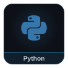
  
  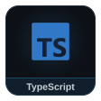
  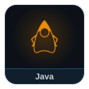
  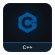
  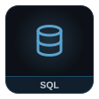

  <b>AI, ML &amp; Data</b> 
  
  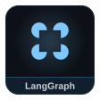
  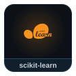
  
  
  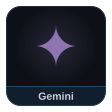

  <b>Backend &amp; Architecture</b> 
  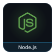
  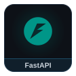
  
  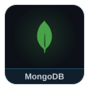
  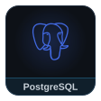
  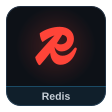
  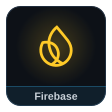

  <b>Cloud &amp; DevOps</b> 
  
  
  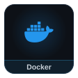
  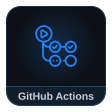
  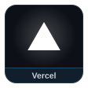
  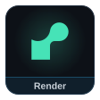
  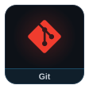

  <b>Frontend Engineering</b> 
  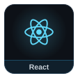
  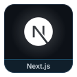
  
  

---

### 🏅 Highlights
- 🥉 **3rd Place**, ABES Cloud Hackathon (2026)
- ✅ Qualified for the advanced rounds of **Battle of Brains**, ABESEC (2024)
- 📜 **Exploratory Data Analysis**, FutureSkills Prime (NASSCOM)
- 💡 **C++ STL** certificate, CodeChef

---

### 🧠 Coding Profiles

  <a href="https://leetcode.com/u/kaushlendra2580/" target="_blank">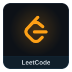</a>
  
  
  <a href="https://codeforces.com/profile/kp_the_solver" target="_blank">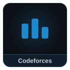</a>

---

### 📊 GitHub Stats

  
  

<!-- Pull requests opened and merged (all time) -->

  
  

  <a href="https://github.com/pulls?q=is%3Apr+author%3Akaushlendra-pt-singh">
    <em>See all my pull requests →</em>
  </a>

<!-- Contribution snake (generated by .github/workflows/snake.yml) -->

  <picture>
    <source media="(prefers-color-scheme: dark)" srcset="https://raw.githubusercontent.com/kaushlendra-pt-singh/kaushlendra-pt-singh/output/github-snake-dark.svg" />
    <source media="(prefers-color-scheme: light)" srcset="https://raw.githubusercontent.com/kaushlendra-pt-singh/kaushlendra-pt-singh/output/github-snake.svg" />
    
  </picture>

---

### ⚡ Beyond the Code
When I'm not obsessing over API routing or UI transition timings, you can find me:
- 🧙‍♂️ Exploring high-fantasy lore (*LOTR, GOT, Star Wars*).
- 🦇 Catching up on cinematic universes (*DC, Mistborn*).
- 🏏 Following the Cricket season (Bleed Yellow! 🦁💛).

---

### 📫 Let's Connect
Open to internships, open-source collaboration and interesting AI/full-stack problems. The quickest way to reach me is [email](mailto:kaushlendrapratapsingh631@gmail.com) or [LinkedIn](https://www.linkedin.com/in/kaushlendra-pt-singh/).

<!-- Animated footer (same gradient as the banner) -->

  

